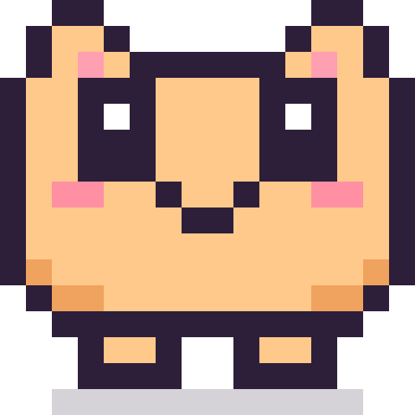

<p align="center"></p>

# Mochi, a pixel-art pet for Claude Code

Mochi is a little animated pixel-art cat that lives in a panel beside your Claude Code chat and reacts to what Claude is doing:

- **Idle**: breathes gently and blinks now and then.
- **Working**: taps away on a tiny laptop while Claude works on a reply.
- **Sleeping**: dozes off, Z's floating up, after 90 seconds with nothing going on.
- **Happy**: jumps with its arms up and sparkles when a reply finishes.
- **Alert**: bounces and waves under a "Claude has a question!" speech bubble whenever Claude asks you something or needs your approval, and sends one desktop notification (taken back once you've answered).

The button under Mochi pets it, or during an alert, takes you to the question: in the terminal it scrolls the chat there; in the desktop app, which doesn't let mods scroll the chat, it points you to the question at the bottom of the chat.

Type `/pet` to bring the panel back if you close it.

## Mochi on your desktop (Windows)

Mochi can also live on your Windows desktop, outside the Claude window, in a see-through window that stays on top. It never starts by itself: type `/pet desktop` in a Claude chat to start it. Each session reports how it is doing, and the desktop Mochi shows the busiest of them:

- **One line above Mochi's head per chat that needs you**: "website: has a question!", "api-server: done ✓". Click a line to open that chat in the Claude app; the line clears until something new happens there.
- **Click Mochi** to open the chat that needs you most (or the one you used last) and hush the sound. Going to the Claude window yourself hushes it too: the waving and the sound stop as soon as Claude is in front, while the line stays until you answer, or click it. And if you are already in Claude and active (mouse or keyboard in the last 2 minutes) when a question or reply comes in, Mochi doesn't ring at all, just shows the line.
- **Tray icon**: Mochi has no taskbar button and stays out of Alt+Tab; its face in the system tray hides or shows it (left-click) and has Open Claude and Quit (right-click).
- **Drag Mochi** anywhere (it hangs on to the cursor with both paws while you carry it); **resize** it with the corner grip or the mouse wheel.
- **Show chats in progress** (on by default): a fainter line for every chat Claude is working on. When nothing runs, or with it off, Mochi shows just itself.
- **Names**: a line names the chat's project folder. Chats with no real folder are "Project 1", "Project 2"...; chats sharing a folder are told apart as "#1", "#2".
- **Wander around** (on by default): now and then, while idle, Mochi walks off left or right until it slams into the edge of the screen, falls over seeing stars, gets up, licks its paw, then either walks back the other way or stands about for a while.
- **DVD bounce mode**: Mochi flies about the screen, bouncing off every edge and changing fur color at each bounce. Put the cursor on it and it stops and holds on to the cursor; move away and it flies on. It parks while a chat needs you, and takes off again after.
- **Zoomies**: after napping for 3 minutes (`napMinutes` in the settings), Mochi takes off DVD style until you catch it with the cursor; then it lands and stays up a minute.
- **Always on top** (on by default): turn it off to let other windows cover Mochi.
- **A sound loops** while a question waits or a finished chat is unseen. Right-click → **Sound** to turn it off or pick it: a ringtone of your own saved as `%USERPROFILE%\.claude\mochi\phone.mp3` (the default when it is there), the built-in chime, or any sound file (WAV, MP3, WMA, M4A).
- Right-click also has size presets and **Quit Mochi**, plus two opt-in settings, both off until you tick them:
  - **Start when Claude starts**: each new Claude session starts desktop Mochi if it isn't running.
  - **Start with Windows**: adds a `Mochi.lnk` shortcut to your Startup folder. Untick it to remove the shortcut.

**What runs, and what it can do.** Desktop Mochi is one Windows PowerShell script, `desktop/mochi-desktop.ps1`, so you can read all of it. `/pet desktop` starts it with Windows PowerShell, with its console window hidden, because Mochi is a window of its own. It uses `-ExecutionPolicy Bypass` for that one process only, because Windows' default policy refuses every unsigned script. The script reads the session reports in `%USERPROFILE%\.claude\mochi\sessions\` and keeps its settings in `%USERPROFILE%\.claude\mochi\desktop.json`. The only thing it ever opens is the Claude app's own `claude://code/continue` link, checked against a fixed pattern. It touches the network only if you turn on the cloud link below.

### Cloud and remote sessions (optional, off by default)

A session that runs somewhere else (a cloud session, or Claude Code on another computer, including one you drive with Remote Control) can't reach your PC by itself. If you choose to, you can link it to Mochi with a key. It then sends its status through [ntfy.sh](https://ntfy.sh), a free third-party push service, and those chats show up on Mochi with a cloud before their name. Nothing is sent and nothing listens until you create a key.

1. On the PC with desktop Mochi, right-click Mochi → **Cloud sessions** → **Copy link key**.
2. On the other side:
   - **Another computer:** install the plugin there (see Install below). Then run [`desktop/connect-this-computer.ps1`](desktop/connect-this-computer.ps1) from the plugin's folder and paste the key when it asks. The script only saves the key to `%USERPROFILE%\.claude\mochi\link.json`. It downloads, installs and starts nothing. Run it with `-Disconnect` to undo.
     ```
     powershell -NoProfile -ExecutionPolicy Bypass -File connect-this-computer.ps1
     ```
   - **Cloud sessions:** in your cloud environment's settings, add an environment variable `MOCHI_LINK` with the key as its value.
3. Start a new chat there, or run `/reload-plugins`.

**Managing the key:** **New link key** cuts off every session that has the old key. **Turn off** stops listening.

**Privacy.** The key works like a password, so keep it private. Only you can work out the ntfy channel name from it, along with the keys that encrypt and sign each message. ntfy.sh sees only scrambled bytes. Messages are sent with `Cache: no` and `Firebase: no`, so ntfy keeps nothing and forwards nothing. A message carries only the folder name, the state (working, idle, question or approval) and timestamps. It never carries paths or session ids. Mochi drops anything unsigned, tampered with, older than 15 minutes or replayed, and it only ever shows a message as text. Sessions on the PC with Mochi never use the network for it.

**Load.** ntfy.sh's free tier allows about 250 messages a day per sender. A remote session sends only when its state changes (at most one message every 5 seconds), plus a heartbeat every 10 minutes. Mochi holds one open connection and does no polling. It forgets a remote session after 25 minutes of silence.

## Install

At the prompt of a Claude Code terminal session:

```
/plugin install pixel-pet --marketplace leonpentastorm/mochi-pixel-pet
```

Answer `y` to add the marketplace, then press Enter to pick the user scope.

From a shell:

```
claude plugin marketplace add leonpentastorm/mochi-pixel-pet
claude plugin install pixel-pet@mochi-pixel-pet --scope user
```

In the Claude desktop app: click **+** next to the prompt box, then **Plugins**, **Add marketplace** with `leonpentastorm/mochi-pixel-pet`, then **Add plugin** and pick **pixel-pet**.

Start a new chat afterwards: Mochi loads when a session starts. Mochi needs a Claude Code version with plugin hooks modules; desktop Mochi needs Windows 10 or 11, which come with Windows PowerShell 5.1.

### Updating and removing

```
claude plugin marketplace update mochi-pixel-pet
claude plugin update pixel-pet@mochi-pixel-pet
```

```
claude plugin uninstall pixel-pet@mochi-pixel-pet
claude plugin marketplace remove mochi-pixel-pet
```

## License

MIT: use, change and share Mochi freely; keep the copyright notice in [LICENSE](LICENSE).
